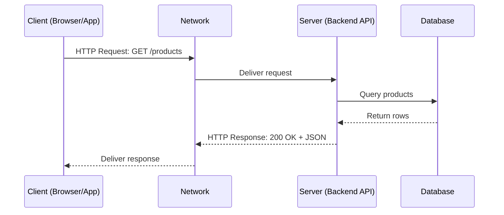
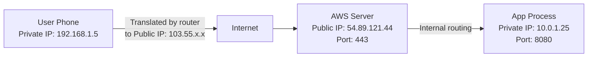
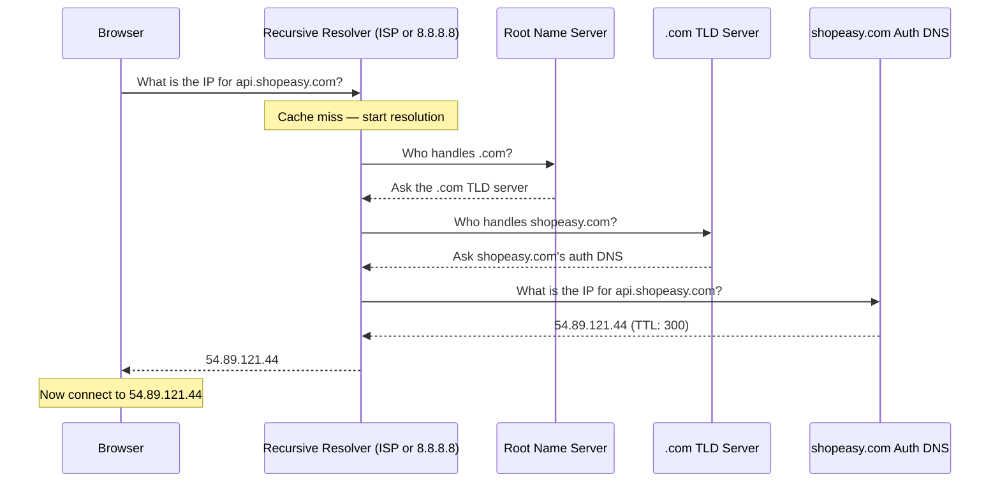
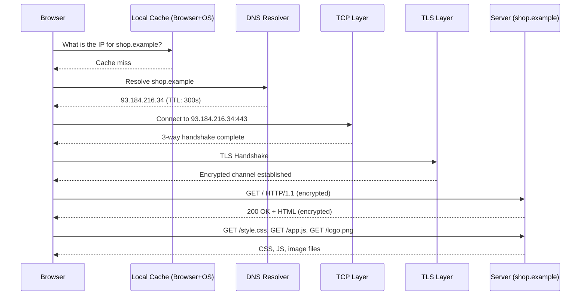

# Networking — exam Preparation Guide

---

## Learning Outcomes

By the end of Day 1 you will be able to:

- Explain what a network is and how client–server communication works.
- Describe how data travels across a network in packets.
- Explain IP addresses, ports, and the difference between public and private IPs.
- Explain what DNS does and why it exists.
- Compare TCP and UDP and choose the right one for a given use case.
- Explain what HTTP and HTTPS do.
- Walk through what happens end-to-end when a user opens a URL.
- Define latency, bandwidth, and throughput and explain how they affect application performance.

---

## Prerequisites

- You write code in at least one backend language (Node.js, Python, Java, Go, or similar).
- You have called an API using `fetch`, `axios`, `curl`, or a similar tool.
- You have a basic idea that websites live on servers somewhere.

No networking background is required.

---

## Estimated Study Time

| Activity | Time |
|---|---|
| Reading and understanding the concepts | 2.5 – 3 hours |
| Practical exercises | 45 minutes |
| End-to-end walkthrough | 30 minutes |
| Reviewing exam answers | 30 minutes |
| **Total** | **~5 hours** |

You can split this across two sessions.

---

## Table of Contents

1. [Scope: What is covered today and what is deferred](#scope)
2. [Networks and the Client–Server Model](#1-networks-and-the-clientserver-model)
3. [Packets: How Data Actually Travels](#2-packets-how-data-actually-travels)
4. [IP Addresses and Ports](#3-ip-addresses-and-ports)
5. [DNS: Domain Name System](#4-dns-domain-name-system)
6. [TCP vs UDP](#5-tcp-vs-udp)
7. [HTTP, HTTPS, and TLS](#6-http-https-and-tls)
8. [Latency, Bandwidth, and Throughput](#7-latency-bandwidth-and-throughput)
9. [End-to-End Walkthrough: What Happens When You Enter a URL](#8-end-to-end-walkthrough)
10. [Practical Exercises](#9-practical-exercises)
11. [Quick Reference: All Comparison Tables](#10-quick-reference)
12. [Final exam Prep: 10 Must-Know Q&A](#11-final-exam-prep)

---

## Scope

| Topic | Status | Notes |
|---|---|---|
| Networks and client–server model | ✅ Today | Foundation for everything |
| Packets and data travel | ✅ Today | Beginner level |
| IP addresses, public vs private, ports | ✅ Today | Must know |
| DNS resolution chain | ✅ Today | Frequently asked |
| TCP vs UDP | ✅ Today | Frequently asked |
| HTTP request/response structure | ✅ Today | Must know |
| HTTPS and TLS purpose | ✅ Today | Purpose only, not internals |
| Latency, bandwidth, throughput | ✅ Today | System design foundation |
| End-to-end URL walkthrough | ✅ Today | Top exam question |
| TLS certificate internals | 🔜 Later | Too deep for Day 1 |
| Subnetting and CIDR notation | 🔜 Later | Ops/DevOps territory |
| Routing protocols (BGP, OSPF) | 🔜 Later | Infrastructure engineering |
| HTTP/2 and HTTP/3 internals | 🔜 Later | Day 2 or 3 |
| Load balancing algorithms | 🔜 Later | System design (Day 6) |
| Congestion control (slow start, AIMD) | 🔜 Later | Advanced TCP internals |

---

## 1. Networks and the Client–Server Model

### A. exam-ready definition

A **network** is a group of computers or devices connected so they can exchange data. The **client–server model** is the most common pattern in software: a client (such as a browser or mobile app) sends a request to a server, the server processes it, and sends back a response. The two machines communicate over this network.

### B. Explanation in simple language

When you open an app on your phone and see your order history, the app did not store that data locally. It sent a request over the internet to a server, the server looked up your data in a database, and sent it back.

This is the **client–server model**:

- The **client** is anything that initiates a request — a browser, a mobile app, or another service.
- The **server** is a machine (or a program on a machine) that listens for requests and sends responses.
- The **network** is the infrastructure that carries the request from the client to the server and the response back.

In real backend work, the server is often your application (a Node.js or Python service), and the client is the browser or a mobile app. But the same pattern applies to service-to-service communication inside a company's infrastructure.

### C. Why this concept exists

Before networks, every computer worked alone. To share data you physically moved a storage device between machines. Networks removed this constraint. The client–server model introduced a clean separation: clients focus on the interface and user interaction, servers focus on data and business logic. This separation lets you update the backend without changing every client, and serve millions of clients from a small number of servers.

### D. Real-life analogy

Think of a restaurant. You (the client) sit at a table and place an order with the waiter. The waiter carries your order to the kitchen (the server). The kitchen prepares the food and sends it back through the waiter.

- You = client
- The waiter = the network
- The kitchen = the server
- The menu = the API (the list of things you can request)

Where the analogy breaks down: in networking, the "waiter" does not understand your order — it just carries packets of bytes. The kitchen (server) figures out what you wanted.

### E. Practical software example

You are building an e-commerce app called **ShopEasy**. When a user opens the app:

1. The mobile app (client) sends a request: *"Give me the list of products on sale."*
2. The request travels over the internet (the network) to your backend API server.
3. The server queries the database and returns a JSON list of products.
4. The app displays the products.

As a backend developer you write the server side: receiving the request, processing it, and returning the correct response.

### F. How it works

```
Client (browser/app)
    │
    │   1. Client initiates a request
    ▼
Network (internet — a series of routers and cables)
    │
    │   2. Request travels in small chunks called packets
    ▼
Server (your backend application)
    │
    │   3. Server processes the request
    ▼
Network
    │
    │   4. Response travels back to client
    ▼
Client receives response and displays it
```

### G. Diagram



**Key takeaway:** The network is just the delivery layer. The client and server do the actual work.

### H. When it is used

Every time you make an API call, fetch data, or authenticate a user, the client–server model is involved. When your backend service calls another service (a payment gateway, an SMS provider, or a microservice), it is acting as a client to that other service's server. Understanding this model is the starting point for all backend development.

### I. Common mistakes and misconceptions

**Misconception:** The server is always more powerful than the client.
**Correction:** "Client" and "server" are roles, not hardware descriptions. Your laptop can act as a server (when you run a local dev server). A mobile phone can be a client. The role is defined by who initiates the request.

**Misconception:** There is always exactly one server.
**Correction:** In production, a single domain usually points to multiple server instances behind a load balancer. This is how apps stay available when traffic spikes.

### L. Short exam answer

> "A network is a set of connected machines that can exchange data. The client–server model is the pattern where a client — a browser, an app, or another service — sends a request to a server, which processes it and returns a response. Everything in backend development uses this model: when our mobile app asks for products, it sends an HTTP request over the internet to our API server, which queries the database and responds with JSON. Even service-to-service calls inside a system follow the same pattern."

---

## 2. Packets: How Data Actually Travels

### A. exam-ready definition

A **packet** is a small, fixed-size chunk of data sent over a network. When you send a large piece of data — such as a file or an HTTP response body — the network splits it into packets, sends each one independently, and the receiving end reassembles them in order.

### B. Explanation in simple language

Imagine you want to send a 10-page document to someone. Instead of sending all 10 pages as one block, you send 10 separate envelopes, each containing one page and labelled with the page number.

Each packet contains:
- A small piece of the actual data (the **payload**).
- **Header information**: the source address, destination address, packet number, and other metadata.

The receiving machine collects all the packets and reassembles them using the packet numbers. If a packet is missing, the receiver can ask for it again.

### C. Why this concept exists

If you sent a large file as one continuous stream without breaking it into packets:

- A single error would corrupt the entire file, requiring the whole thing to be resent.
- One large transfer would block other traffic on the shared network.

Packets let the network share bandwidth fairly across many simultaneous connections and make retransmission of lost data cheap (resend one packet, not the whole file).

### D. Real-life analogy

Think of shipping a large piece of furniture from Delhi to Mumbai. Instead of sending it as one enormous delivery, the warehouse breaks it into boxes, labels each box with a sequence number and the destination address, and ships them. Some boxes may take different routes and arrive at different times. The recipient assembles the furniture from all the boxes.

Where the analogy breaks down: network packets are all the same size limit and travel at nearly the speed of light, unlike furniture boxes.

### E. Practical software example

When a user on ShopEasy downloads a product image (say, 500 KB), the server does not send all 500 KB as one transmission. The network splits it into packets, typically up to about 1.5 KB each (limited by the **MTU** — Maximum Transmission Unit). The browser receives around 330 packets, reassembles them, and displays the image.

If one packet is lost (common on mobile networks), only that packet is retransmitted, not the entire image.

### F. How it works

1. Your application hands data to the network stack (the OS handles this, not your code directly).
2. The network stack adds headers: source IP, destination IP, sequence number.
3. Each packet travels independently through the network — possibly through different routers and different physical routes.
4. The destination machine's network stack receives packets, checks for errors, and reassembles them in order.
5. Your application on the other side reads the reassembled data as if it were one continuous stream.

**Note:** As a backend developer you almost never deal with packets directly. TCP (covered in section 5) handles this for you. Understanding packets matters for reasoning about network failures, retransmission delays, and throughput.

### I. Role, constraints, and common sources of confusion

**Confusion:** "Packet loss only happens on bad connections."
**Correction:** Packet loss happens on all networks, including data centres. It is normal at very low rates (0.01–0.1%). TCP handles this automatically by retransmitting lost packets. High packet loss (1%+) causes noticeable performance problems.

**Confusion:** "Larger packets are always better."
**Correction:** Larger packets carry more data per header, but they are also more affected by single-bit errors and take longer to retransmit if lost. The MTU is a balance point.

### L. Short exam answer

> "A packet is a small chunk of data — typically up to around 1.5 KB — that the network uses to send information. Large data is split into packets at the sender, each packet is labelled with a sequence number and the destination address, and they travel through the network independently. The receiver reassembles them in order. This matters in backend work because packet loss causes TCP to retransmit, adding latency, and understanding this helps me reason about timeouts and performance on unreliable connections."

---

## 3. IP Addresses and Ports

### A. exam-ready definition

An **IP address** is a numerical label assigned to every device on a network. It tells the network where to deliver a packet. A **port** is a number (0–65535) that identifies a specific application or process on a device. Together, an IP address and a port identify a specific communication endpoint — this combination is called a **socket**.

### B. Explanation in simple language

**IP Address — the building address**

Every device connected to a network has an IP address. It works like a postal address: it tells the network which building (device) to deliver the data to.

An IPv4 address looks like: `142.250.182.46` — four numbers from 0 to 255, separated by dots.

**Port — the flat number inside the building**

Many different applications run on the same server: a web server, a database, an SSH service. The port number tells the OS which application should receive the incoming data.

```
192.168.1.10 : 8080
[IP address]   [port]
    │              │
 Which machine  Which application
```

**Common ports you must know:**

| Port | Protocol | Used for |
|---|---|---|
| 80 | HTTP | Unencrypted web traffic |
| 443 | HTTPS | Encrypted web traffic |
| 22 | SSH | Secure shell (remote access) |
| 5432 | PostgreSQL | PostgreSQL database |
| 3306 | MySQL | MySQL database |
| 6379 | Redis | Redis cache |
| 27017 | MongoDB | MongoDB database |

### C. Why this concept exists

Without IP addresses, a packet has no destination — the network cannot route it. Without ports, the OS on the receiving machine cannot decide which application should receive the data. Both are required to deliver a packet to the right program on the right machine.

### D. Real-life analogy

Imagine an apartment building:
- The **IP address** is the building's postal address (12, MG Road, Bengaluru).
- The **port** is the flat number (Flat 443).

A letter arrives at the building (the server). The postman uses the building address (IP) to find the right building, and the flat number (port) to deliver to the right resident (the application).

Where the analogy breaks down: many applications can share ports in certain configurations, and the source port of a connection also matters — but this is an advanced detail.

### E. Practical software example — Public IP vs Private IP

When your ShopEasy backend runs on AWS EC2:

- The server gets a **private IP** like `10.0.1.25` — this is only visible inside the AWS network.
- AWS assigns it a **public IP** like `54.89.121.44` — this is what the internet sees.
- Your DNS record (`api.shopeasy.com`) points to `54.89.121.44`.
- Traffic from the internet hits `54.89.121.44` and AWS routes it internally to `10.0.1.25`.

This separation is intentional: private IPs protect internal machines from being directly accessible from the internet.

### F. Public IP vs Private IP

| Aspect | Public IP | Private IP |
|---|---|---|
| Assigned by | Your ISP or cloud provider | Your router or internal network |
| Visible on internet | Yes | No |
| Range example | Any address not in private ranges | `10.x.x.x`, `192.168.x.x`, `172.16–31.x.x` |
| Unique globally | Yes | Only within the local network |
| Example | `54.89.121.44` | `192.168.1.10` |

**Why private IPs exist:** IPv4 has about 4.3 billion addresses. The world has far more than 4.3 billion devices. Private IP ranges let millions of home and corporate networks each use the same internal address space (`192.168.x.x`) without conflicts, because these addresses are never exposed directly to the internet. This is enabled by **NAT** (Network Address Translation) — your router translates private IPs to its single public IP.

### G. Diagram



**Key takeaway:** The internet routes using public IPs. Private IPs only exist inside a local network or cloud VPC.

### H. When it is used

- When you configure a server to listen on a port (e.g., `app.listen(3000)`), you are telling the OS to route incoming traffic on port 3000 to your process.
- When you connect to a database from your backend, you use the database's IP (or hostname) and its port (`5432` for Postgres).
- When you deploy on AWS or GCP, security groups control which ports accept traffic from the internet.
- Knowing that your API runs on port 443 (HTTPS) in production, but 3000 locally, is a practical day-to-day detail.

### I. Common mistakes and misconceptions

**Misconception:** Port 80 and port 443 are the only ports that matter.
**Correction:** Every service uses a port. Your database, cache, message queue, and internal APIs all use specific ports. Misconfigured firewall rules blocking the wrong port is a common deployment issue.

**Misconception:** My laptop has one IP address.
**Correction:** Your laptop has multiple: a loopback address (`127.0.0.1`, only reachable by your own machine), a private IP on your home network, and possibly a virtual IP from a VPN. Your public IP belongs to your router, not your laptop.

**Misconception:** Ports are physical connectors on the machine.
**Correction:** Network ports in this context are software concepts — numbers in a packet header that the OS uses to route incoming data. They have nothing to do with USB ports or Ethernet jacks.

### L. Short exam answer

> "An IP address is the network-level address of a device — it tells the network where to deliver a packet. A port is a number that identifies which application on that device should receive the data. Together they form a socket. In our backend, when we deploy the API server on port 443, the OS uses the port to route incoming HTTPS traffic to our application. Private IPs like 192.168.x.x are only visible inside a local or cloud network, so in production we expose a public IP through a load balancer or API gateway, and the actual application servers stay on private IPs for security."

---

## 4. DNS: Domain Name System

### A. exam-ready definition

**DNS (Domain Name System)** is a distributed system that translates human-readable domain names (like `api.shopeasy.com`) into IP addresses (like `54.89.121.44`) that the network uses to route traffic. It works like a phonebook: you look up a name and get a number.

### B. Explanation in simple language

Computers communicate using IP addresses, not names. But humans cannot remember `142.250.182.46`. DNS solves this by acting as a lookup service: give it a name, it gives you the IP.

When you type `google.com` in your browser, the browser does not know where Google's servers are. It asks a DNS server. The DNS server looks up `google.com` and returns `142.250.182.46`. Now the browser knows where to connect.

**DNS is not one single server.** It is a hierarchy of servers distributed across the world.

### C. Why it exists

Without DNS, every user would need to remember the IP address of every website. More importantly, IP addresses change — when Google moves its servers, it gets new IPs. With DNS, the domain name stays the same and the DNS record is updated once. All users automatically reach the new IP on their next lookup without changing anything.

### D. Real-life analogy

DNS is like a company's internal phone directory. You do not memorise everyone's extension. You look up "Finance Department" → get extension 2045 → call that number. If Finance moves to a new extension, the directory is updated and you never need to know the old one.

Where the analogy breaks down: DNS is a global, distributed system with caching. A phone directory is centralised and small.

### E. Practical software example

ShopEasy has a backend API at `api.shopeasy.com`. You have registered this domain and created a DNS record:

```
Type: A
Name: api.shopeasy.com
Value: 54.89.121.44
TTL: 300
```

When a user's app makes a request to `api.shopeasy.com`:
1. The app asks its DNS resolver: "What is the IP for api.shopeasy.com?"
2. The resolver finds the record and returns `54.89.121.44`.
3. The app connects to `54.89.121.44` on port 443.

When you move the API to a new server (`54.89.200.11`), you update the DNS record. After the TTL (300 seconds = 5 minutes) expires, all clients automatically use the new IP.

### F. How DNS resolution works (the full chain)



**Order of resolution (fastest to slowest):**

1. **Browser cache** — did I resolve this in the last few minutes?
2. **OS cache** — does the OS have a recent answer?
3. **Recursive Resolver** — your ISP's DNS server, or a public one like `8.8.8.8` (Google) or `1.1.1.1` (Cloudflare). This server does the hard work and caches the result.
4. **Root → TLD → Authoritative** — the full chain, only if the resolver has no cached answer.

**Key point:** In practice, the full chain is rarely traversed. The recursive resolver caches answers for the duration of the TTL, so most lookups are answered immediately from cache.

### G. DNS Record Types You Must Know

| Record | What it does | Example |
|---|---|---|
| A | Maps a domain to an IPv4 address | `api.shopeasy.com → 54.89.121.44` |
| AAAA | Maps a domain to an IPv6 address | `api.shopeasy.com → 2607:f8b0::1` |
| CNAME | Alias — maps one domain to another domain | `www.shopeasy.com → shopeasy.com` |
| MX | Points to the mail server for a domain | `shopeasy.com → mail.google.com` |
| TXT | Stores text data (used for SPF, DKIM, domain verification) | `v=spf1 include:google.com` |

**TTL (Time To Live):** Every DNS record has a TTL in seconds. Once the TTL expires, the cached answer is discarded and a fresh lookup happens. A low TTL (60–300 s) lets you change IPs quickly. A high TTL (86400 s = 1 day) reduces DNS traffic but means changes propagate slowly.

### H. Connection to system design

- **Changing servers:** DNS lets you update the IP behind a domain without touching clients. This is how blue-green deployments work at the DNS level.
- **Load balancing via DNS:** You can have multiple A records for one domain. Some DNS setups rotate between them, giving each client a different server IP. This is called DNS-based load balancing.
- **CDN:** A CDN like Cloudflare uses DNS to return the IP of the CDN edge node closest to the user, not the origin server directly.
- **DNS failure:** If DNS resolution fails, your application cannot resolve service hostnames. In a microservices architecture where services call each other by hostname, a DNS issue can cascade into multiple service failures.

### I. Common mistakes and misconceptions

**Misconception:** Changing a DNS record takes effect immediately.
**Correction:** Changes are propagated based on TTL. If your current TTL is 3600 s (1 hour), it may take up to an hour for all resolvers worldwide to pick up your change. Before a planned migration, lower the TTL to 60 s a day in advance.

**Misconception:** A domain name and an IP address are the same thing.
**Correction:** They are completely different. A domain name is a human-readable label. An IP address is a numerical network address. DNS maps one to the other.

**Misconception:** One domain always maps to one IP.
**Correction:** A domain can have multiple A records pointing to multiple IPs (used for load balancing and redundancy). One IP can also serve many domains (used in shared hosting and virtual hosting using the `Host` HTTP header).

### L. Short exam answer

> "DNS is the system that translates domain names like api.shopeasy.com into IP addresses that the network can use to route traffic. When my app makes a request, it first checks local caches — browser cache, OS cache, then a recursive resolver — before doing a full lookup through root and authoritative name servers. The answer is cached for the record's TTL. In backend work, DNS matters for deployments — when I move a server, I update the DNS A record and wait for the TTL to expire. It also matters in microservices, because if DNS resolution fails, services can't find each other by hostname."

---

## 5. TCP vs UDP

### A. exam-ready definition

**TCP (Transmission Control Protocol)** is a connection-oriented transport protocol that guarantees reliable, ordered delivery of data between two endpoints. **UDP (User Datagram Protocol)** is a connectionless protocol that sends data without guaranteeing delivery, ordering, or duplication prevention. The right choice depends on whether the application needs guaranteed delivery or prioritises speed and low overhead.

### B. Explanation in simple language

Both TCP and UDP are about sending data between two machines. The difference is in the guarantees they make.

**TCP makes three guarantees:**
1. **Reliability:** If a packet is lost, TCP detects this and retransmits it automatically.
2. **Ordering:** Data arrives in the same order it was sent.
3. **Error checking:** Corrupted data is detected and discarded (then retransmitted).

To do this, TCP establishes a connection first (the 3-way handshake), maintains state throughout the conversation, and uses acknowledgements — the receiver confirms every piece of data it gets.

**UDP makes no guarantees.** It sends data and does not check whether it arrived. There is no connection setup, no acknowledgement, no retransmission. It is much simpler and has less overhead.

### C. Why both exist

TCP's reliability mechanisms add overhead: the handshake takes time, acknowledgements consume bandwidth, and retransmission causes delays. For some applications, this overhead is unacceptable:

- In a video call, a retransmitted packet from 200 ms ago is useless. You would rather skip a frame than pause the entire video to resend it.
- In a multiplayer game, old position data that arrives late is harmful — you need the latest position, not a retransmit of a stale one.

UDP lets these applications send data as fast as possible and handle any reliability requirements themselves (if at all).

### D. Real-life analogy

**TCP = Registered mail.** You send a letter. The postal service confirms delivery. If it gets lost, they resend it. You wait until it is confirmed before sending the next.

**UDP = Throwing flyers from a car window.** You throw them out as fast as you can. Some people catch them. Some fall in the road. You do not check, and you do not stop to resend.

Where the analogy breaks down: TCP does not literally wait for acknowledgement before sending the next packet — it uses a window of many packets in flight — but the analogy captures the reliability intent.

### E. Practical software example

For ShopEasy:

- The product API (`GET /products`) uses **HTTP over TCP**. If a packet is lost, you need the complete response. A partial or out-of-order JSON response is useless.
- If you later add a **live inventory count** widget that updates every second showing "152 people viewing this item", you might use **UDP or WebSockets**. A missed update just means the counter shows the previous value for one second — acceptable.
- **DNS queries** use **UDP** (port 53). A DNS query is tiny (fits in one packet). If it fails, the client just sends it again. The overhead of a TCP handshake for a 60-byte query is not worth it.

### F. The 3-Way Handshake (TCP connection setup)

Before TCP sends any application data, it establishes a connection:

```
Client                        Server
  |                              |
  |── SYN ──────────────────────>|  "I want to connect, my sequence starts at X"
  |                              |
  |<── SYN-ACK ─────────────────|  "OK, I'm ready, my sequence starts at Y"
  |                              |
  |── ACK ──────────────────────>|  "Confirmed, let's communicate"
  |                              |
  |═══ DATA (application) ══════>|  (actual HTTP request, etc.)
```

**Why does this matter for backend work?**

Every TCP connection costs one round-trip before data can flow. On a high-latency connection (say, 100 ms RTT), just establishing the connection takes 100 ms before a single byte of your API response travels. This is why persistent connections and connection pooling matter.

### G. TCP vs UDP Comparison

| Feature | TCP | UDP |
|---|---|---|
| Connection setup | Required (3-way handshake) | None |
| Delivery guarantee | Yes — retransmits lost packets | No |
| Ordering | Yes — delivers in order | No — may arrive out of order |
| Error checking | Yes | Basic checksum only |
| Speed | Slower (overhead from guarantees) | Faster (no overhead) |
| Use when | Data must be complete and correct | Speed matters, loss is tolerable |
| Examples | HTTP/HTTPS, SSH, email, database connections | Video calls, gaming, DNS, live streaming |

> **Important:** TCP and UDP are not universally "better" or "worse" than each other. One fits certain use cases better than the other. In an exam, always explain *why* based on the application's requirements.

### H. Connection to system design

- **Connection pooling:** Creating a new TCP connection for every database query is expensive (handshake overhead). Backend applications maintain a pool of pre-established connections. This is why connection pool size is a tuning parameter in Postgres, MySQL, and most ORMs.
- **Timeouts:** TCP connections that are idle may be silently dropped by firewalls or NAT devices after a few minutes. Backend services must set appropriate keep-alive or timeout settings.
- **Network failures:** TCP will keep retrying a lost packet. If a downstream service is slow, your connection is not immediately dropped — your request just waits. This is why timeouts are critical: without them, slow services cause upstream services to accumulate waiting connections until they run out of resources.
- **WebSockets:** WebSockets run on top of TCP. They reuse an established connection for bidirectional communication, avoiding the overhead of a new handshake per message.

### I. Common mistakes and misconceptions

**Misconception:** TCP reliability means your application logic is reliable.
**Correction:** TCP guarantees the bytes arrive correctly. It does not guarantee your business logic is correct. A TCP-delivered response can still be a 500 error, a partial JSON payload if your application has a bug, or an incorrect result.

**Misconception:** UDP is always faster than TCP.
**Correction:** On a reliable network, both are fast. On an unreliable network, TCP's retransmission may actually be faster than an application implementing its own retransmission over UDP incorrectly. "UDP is faster" is only true when loss is acceptable or the application handles reliability itself more efficiently.

**Misconception:** TCP sends data as discrete messages.
**Correction:** TCP is a **byte stream**. It has no concept of message boundaries. If you send `"Hello"` and `"World"` as two separate sends, the receiver might get `"HelloWorld"` in one read, or `"Hell"` + `"oWorld"` in two reads. This is why protocols like HTTP add Content-Length or chunked transfer encoding — to define message boundaries on top of TCP.

### L. Short exam answer

> "TCP and UDP are both transport protocols. TCP provides reliability: it establishes a connection with a 3-way handshake, guarantees that all packets arrive in order, and retransmits any that are lost. UDP is connectionless and makes no delivery guarantees — it just sends data. I use TCP when the application needs complete, correct data — like an API response or a database query. I use UDP when speed matters and loss is tolerable — like DNS lookups, video calls, or live game updates. In backend work, TCP's connection overhead is why we use connection pooling for databases, and why setting proper timeouts is critical."

---

## 6. HTTP, HTTPS, and TLS

### A. exam-ready definition

**HTTP (HyperText Transfer Protocol)** is an application-layer protocol that defines how clients and servers exchange requests and responses. It is built on top of TCP. **HTTPS** is HTTP with an additional **TLS (Transport Layer Security)** layer that encrypts the communication between client and server. TLS prevents third parties from reading or tampering with data in transit.

### B. HTTP: Explanation in simple language

HTTP defines the *format* of messages between client and server. A client sends an **HTTP request** and the server sends back an **HTTP response**. Both have a defined structure.

**HTTP Request:**
```
GET /products?category=shoes HTTP/1.1
Host: api.shopeasy.com
Authorization: Bearer eyJhbGc...
Accept: application/json
```

- **Method:** What you want to do (`GET`, `POST`, `PUT`, `DELETE`, `PATCH`).
- **Path:** Which resource you are accessing (`/products`).
- **Headers:** Metadata about the request (authentication token, content type, language).
- **Body:** Data sent with the request (used in `POST` and `PUT`, empty in `GET`).

**HTTP Response:**
```
HTTP/1.1 200 OK
Content-Type: application/json
Content-Length: 1240

{"products": [...]}
```

- **Status code:** Was the request successful? What went wrong?
- **Headers:** Metadata about the response.
- **Body:** The actual data.

### C. HTTP Methods and Idempotency

| Method | Purpose | Idempotent | Has Body |
|---|---|---|---|
| GET | Fetch a resource | Yes | No |
| POST | Create a new resource | No | Yes |
| PUT | Replace a resource entirely | Yes | Yes |
| PATCH | Partially update a resource | No (usually) | Yes |
| DELETE | Remove a resource | Yes | No |

**Idempotent** means calling the same request multiple times produces the same result as calling it once.

- `DELETE /users/5` ten times = user 5 is deleted (same outcome each time) ✅
- `POST /orders` ten times = ten orders created ❌ (not idempotent)

This matters when building retry logic: you can safely retry idempotent requests. You should not blindly retry `POST` without checking whether the first request succeeded.

### D. HTTP Status Codes You Must Know

| Code | Meaning | When to use |
|---|---|---|
| 200 | OK | Request succeeded, body has data |
| 201 | Created | Resource was created (after POST) |
| 204 | No Content | Success, but no body (after DELETE) |
| 400 | Bad Request | Client sent invalid data |
| 401 | Unauthorized | Not authenticated (who are you?) |
| 403 | Forbidden | Authenticated but not authorised (wrong role) |
| 404 | Not Found | Resource does not exist |
| 409 | Conflict | Request conflicts with current state (duplicate) |
| 422 | Unprocessable Entity | Validation failed |
| 429 | Too Many Requests | Rate limit exceeded |
| 500 | Internal Server Error | Bug in your server |
| 502 | Bad Gateway | Upstream server returned a bad response |
| 503 | Service Unavailable | Server is down or overloaded |
| 504 | Gateway Timeout | Upstream server did not respond in time |

**Key distinction: 401 vs 403**
- **401:** The server does not know who you are. You need to log in and send a token.
- **403:** The server knows exactly who you are, but you do not have permission for this action.

**Key distinction: 502 vs 503**
- **502:** Your load balancer or API gateway reached the backend, but the backend returned garbage or crashed mid-response.
- **503:** The load balancer cannot reach any backend at all (all backends are down or overloaded).

### E. HTTPS and TLS

**Why HTTP alone is not enough:**

When you send a plain HTTP request, every router, ISP, and network device between you and the server can read your data — passwords, tokens, card numbers. Anyone on the same WiFi network can intercept it.

**HTTPS** adds TLS between TCP and HTTP:

```
Application layer:  HTTP (request and response)
                        ↕
Security layer:     TLS (encryption and authentication)
                        ↕
Transport layer:    TCP (reliable delivery)
                        ↕
Network layer:      IP (routing)
```

TLS does two things:
1. **Encryption:** The data is encrypted. Even if someone intercepts it, they cannot read it.
2. **Authentication:** The server presents a digital certificate. Your browser verifies it was issued by a trusted authority. This proves you are talking to the real `api.shopeasy.com`, not an impersonator.

**What TLS does not do:** TLS does not guarantee the website is trustworthy or legitimate. It only guarantees the connection is encrypted and the domain is who they claim to be. A phishing site can have valid HTTPS.

### F. HTTP vs HTTPS Comparison

| Aspect | HTTP | HTTPS |
|---|---|---|
| Port | 80 | 443 |
| Encryption | None — plaintext | TLS encryption |
| Authentication | None | Server identity verified via certificate |
| Speed | Slightly faster (no TLS overhead) | Marginally slower (TLS handshake once per connection) |
| Use in production | Never for sensitive data | Always |

### G. Connection to system design

- **API design:** Choosing the right status code and method in your REST API is part of designing a good interface. Returning 200 for a failed operation confuses clients.
- **Retry logic:** Knowing which status codes are retryable (503, 504) vs which are not (400, 401) determines how you build resilient service-to-service calls.
- **Security:** Running HTTP in production exposes credentials and user data. Always terminate TLS at the load balancer at minimum.
- **Headers in practice:** `Content-Type`, `Authorization`, `Cache-Control`, `X-Request-ID` — you write and read headers constantly in backend development.

### H. Common mistakes and misconceptions

**Misconception:** HTTPS means the website is safe and trustworthy.
**Correction:** HTTPS means the *connection* is encrypted and the domain name is authenticated. It says nothing about what the server does with your data or whether the site is malicious.

**Misconception:** Use 200 for everything and put the error in the response body.
**Correction:** Clients and monitoring tools use status codes. Returning 200 for errors breaks API clients, logging systems, and alerting. Always use the correct status code.

**Misconception:** The `Authorization` header is encrypted in HTTPS, but the URL is not.
**Correction:** With HTTPS, the entire request — including headers, body, and URL path — is encrypted after the TLS handshake. The only part visible to a network observer is the domain name (via SNI during TLS handshake), not the path or query parameters.

### L. Short exam answer

> "HTTP is the protocol that defines how clients and servers exchange requests and responses. A request has a method, path, headers, and optional body. The response has a status code, headers, and body. HTTPS adds TLS on top of TCP, which encrypts all communication and authenticates the server's identity using a certificate. In backend work I use HTTP status codes to communicate results clearly — 201 for created, 400 for bad input, 401 for missing authentication, 403 for insufficient permissions. One important distinction: 401 means the user is not authenticated, 403 means they are authenticated but not authorised."

---

## 7. Latency, Bandwidth, and Throughput

### A. exam-ready definition

**Latency** is the time it takes for a single piece of data to travel from source to destination, typically measured in milliseconds. **Bandwidth** is the maximum amount of data that can be transferred per second, measured in bits per second. **Throughput** is the actual amount of data successfully transferred per second in practice, which is always less than or equal to bandwidth.

### B. Explanation in simple language

**Latency — the delay**

Latency is how long it takes for a request to make a round trip: from your client to the server and back. It is measured in milliseconds (ms).

Latency comes from:
- **Physical distance:** Light travels fast but not instantaneously. A request from Mumbai to a server in London takes about 120–150 ms just to traverse the distance.
- **Network hops:** Each router the packet passes through adds a tiny delay.
- **Processing time:** The server needs time to run your code and query the database.
- **Queuing:** If a router or server is busy, packets wait.

**Bandwidth — the pipe size**

Bandwidth is the capacity of the network connection — how much data can flow through per second. A 100 Mbps connection can carry 100 megabits (12.5 megabytes) per second at maximum.

**Throughput — what actually flows**

Throughput is the actual data transferred per second. It is always less than bandwidth due to packet loss, protocol overhead, congestion, and retransmissions.

### C. A simple example

You are downloading a 100 MB file from a server with:
- Bandwidth: 100 Mbps
- Latency: 50 ms (round trip)

**Theoretical transfer time (bandwidth only):**
```
100 MB = 800 Mb
Time = 800 Mb / 100 Mbps = 8 seconds
```

**Reality:** The actual time will be longer because:
- TCP's slow start mechanism does not use full bandwidth immediately.
- The TLS and TCP handshakes take a few round trips before data flows.
- Any packet loss causes retransmission delays.
- A 50 ms latency means each retransmit costs at least 50 ms.

**Key insight:** For small API responses (a few KB of JSON), bandwidth barely matters. Latency dominates — the time to establish the connection and round-trip matters more than the transfer time of a small payload.

### D. Latency vs Bandwidth vs Throughput

| Concept | Unit | Analogy | What improves it |
|---|---|---|---|
| Latency | Milliseconds (ms) | How long it takes one car to drive from A to B | CDN, fewer hops, server closer to user |
| Bandwidth | Mbps / Gbps | How many lanes the highway has | Bigger network connection |
| Throughput | Mbps (actual) | How many cars actually reach B per minute | Reduce loss, increase bandwidth, reduce congestion |

**Important distinction — bits vs bytes:**
- Bandwidth is measured in **bits per second** (Mbps, Gbps).
- File sizes are measured in **bytes** (MB, GB).
- 1 byte = 8 bits.
- A 100 Mbps connection transfers at most 12.5 MB per second, not 100 MB.

### E. Connection to system design

- **Database queries:** A database on the same machine has ~0.1 ms latency. A database across a data centre adds 1–5 ms. A database in another region adds 50–200 ms. This is why you want your database in the same region as your application.
- **External API calls:** Calling a third-party payment API from your backend adds its round-trip latency to every checkout request. If it takes 300 ms, your checkout endpoint takes at least 300 ms.
- **Caching:** Caching reduces latency by serving data from a fast in-memory store (Redis: ~1 ms) instead of a database query (5–50 ms) or an external API call (100–500 ms).
- **CDN:** A CDN reduces latency for static files by serving them from a server physically close to the user. Instead of a user in Chennai fetching images from a US server (200 ms latency), they fetch from a Chennai CDN node (~5 ms).
- **Timeouts:** Every external call in your backend should have a timeout configured. Without a timeout, a high-latency dependency can cause your threads or connections to accumulate waiting, eventually exhausting resources.

### F. Common mistakes and misconceptions

**Misconception:** High bandwidth means low latency.
**Correction:** They measure different things. A fibre connection with 1 Gbps bandwidth still has non-zero latency based on physical distance. Bandwidth and latency are independent. You can have high bandwidth with high latency (a satellite connection: huge capacity but ~600 ms round trip to a geostationary satellite).

**Misconception:** Latency only matters for users, not for backend services.
**Correction:** Service-to-service latency compounds. If your checkout service calls the inventory service (10 ms), the pricing service (15 ms), and the payment gateway (200 ms) sequentially, your total latency is 225 ms minimum. Backend engineers care deeply about latency between services.

### L. Short exam answer

> "Latency is the time for data to travel from source to destination — measured in milliseconds. Bandwidth is the capacity of the network connection, measured in bits per second. Throughput is how much data actually transfers per second in practice, which is always less than bandwidth. For small API responses, latency dominates — the handshake and round trip take more time than sending a few kilobytes. For large file transfers, bandwidth matters more. In system design, I reduce latency by placing services in the same region as their dependencies, using caching to avoid slow database or API calls, and using a CDN for static assets."

---

## 8. End-to-End Walkthrough

## What happens when I enter `https://shop.example` in my browser?

This section ties together everything from Day 1.

### Assumptions

- This is a **first visit** — no cached DNS, no existing TCP connection.
- The server uses **HTTP/1.1 over TLS 1.3** (simplified; HTTP/2 is common in practice).
- On subsequent visits, the browser may reuse a cached connection, skipping the handshake.

---

### Step-by-Step



---

### Each Step Explained

**Step 1: Parse the URL**

The browser identifies:
- **Scheme:** `https` → use port 443, use TLS
- **Hostname:** `shop.example`
- **Path:** `/` (root)

**Step 2: Check local caches**

The browser checks its DNS cache. The OS checks its cache. If either has a recent record for `shop.example`, the IP is used immediately and DNS resolution is skipped.

**Where delays happen:** None at this step (fast local lookup).
**Failure:** If the hosts file has an incorrect entry, the wrong IP is used.

**Step 3: DNS resolution**

If no cache hit, the browser asks the OS's configured DNS resolver (e.g., `8.8.8.8`). The resolver performs the lookup (root → TLD → authoritative) and returns `93.184.216.34`. The answer is cached for the TTL (e.g., 300 seconds).

**Where delays happen:** First lookup on a cold cache can take 20–200 ms.
**Failure:** DNS lookup fails → browser shows "Server not found". Often caused by misconfigured DNS records, expired domain, or DNS resolver issues.

**Step 4: TCP 3-way handshake**

The browser connects to `93.184.216.34` on port 443. TCP performs:
1. Browser sends SYN.
2. Server responds SYN-ACK.
3. Browser sends ACK.

This takes **one full round trip** (RTT).

**Where delays happen:** On a 100 ms RTT connection, this step alone takes 100 ms.
**Failure:** Connection refused (port 443 not listening), or timeout (server unreachable, firewall blocking).

**Step 5: TLS handshake**

Now that TCP is established, TLS negotiates:
- Which cipher to use.
- Server presents its certificate (proves it is really `shop.example`).
- Both sides derive a shared encryption key.

This takes **one to two additional round trips** (TLS 1.3 is faster, often 1 RTT).

**Where delays happen:** One extra RTT minimum. Certificate validation adds a small amount of processing.
**Failure:** Expired certificate → browser shows security warning. Wrong certificate → browser blocks the connection.

**Step 6: HTTP request**

The browser sends the HTTP request over the now-encrypted connection:
```
GET / HTTP/1.1
Host: shop.example
Accept: text/html
```

**Step 7: Server processing**

The server receives the request and:
- Routes it to the appropriate handler.
- May query a database for product data.
- Renders the response (or returns a cached response).

**Where delays happen:** Database queries (5–50 ms), slow business logic, resource contention.
**Failure:** 500 if the server crashes; 503 if overloaded; 504 if a downstream service times out.

**Step 8: HTTP response**

The server sends back:
```
HTTP/1.1 200 OK
Content-Type: text/html
Content-Length: 14250

<!DOCTYPE html>...
```

**Step 9: Browser processes response**

The browser parses the HTML and finds additional resources: CSS files, JavaScript, images. It sends parallel requests for these. For subsequent requests, the existing TCP+TLS connection is reused (no repeat handshake).

---

### Where Delays Occur: Summary

| Stage | Typical delay | Common cause of extra delay |
|---|---|---|
| DNS resolution | 20–200 ms (cold cache) | High TTL not yet cached, slow resolver |
| TCP handshake | 1 × RTT | High latency to server (far geography) |
| TLS handshake | 1–2 × RTT | TLS 1.2 (older, slower than 1.3) |
| Server processing | 10–500 ms | Slow queries, no caching |
| Response transfer | Depends on size | Small response: negligible |

---

### exam Version (60 seconds)

> "When I enter https://shop.example, the browser first parses the URL: it sees HTTPS, so it will use port 443 with TLS. It checks local caches for a DNS result. On a cold visit, it queries the DNS resolver, which returns the server's IP. The browser then opens a TCP connection — SYN, SYN-ACK, ACK, one round trip. On top of TCP, the TLS handshake runs: the server presents its certificate, the browser verifies it, and they establish an encrypted channel. The browser then sends the HTTP GET request, encrypted. The server processes it, queries the database if needed, and returns a 200 OK with HTML. The browser parses the HTML, finds CSS and JS, and fetches those using the same connection. On repeat visits, DNS and TCP results are cached, so the process is much faster."

---

## 9. Practical Exercises

### Exercise 1 — Inspect a real HTTP request (Browser DevTools)

**Purpose:** See HTTP request and response headers in a real application.

**Steps:**
1. Open Chrome or Firefox.
2. Go to `https://github.com`.
3. Press `F12` to open Developer Tools.
4. Click the **Network** tab.
5. Reload the page (`Ctrl+R` or `Cmd+R`).
6. Click on the first request (usually `github.com`).
7. Look at **Headers** → **General**, **Request Headers**, **Response Headers**.

**What to observe:**
- Request method: `GET`
- Status code: `200 OK`
- `Content-Type` header
- `Cache-Control` header
- Look at the **Timing** tab to see DNS lookup time, TCP connection time, and response time separately.

**What it does not prove:** This shows what the browser and server communicate. It does not show what happens inside the server (database queries, business logic).

**exam connection:** "I use the Network tab to debug slow API responses — I can separate DNS resolution, TCP handshake, TLS overhead, and server response time to find where the bottleneck is."

---

### Exercise 2 — DNS lookup with nslookup

**Purpose:** See DNS resolution in action.

**Command (Windows PowerShell or Command Prompt):**
```
nslookup github.com
nslookup github.com 8.8.8.8
nslookup -type=MX gmail.com
```

**What to observe:**

`nslookup github.com` output will look similar to:
```
Server:  your-isp-dns.net
Address:  192.168.1.1

Non-authoritative answer:
Name:    github.com
Addresses:  20.207.73.82
```

- "Non-authoritative answer" means the resolver returned a cached answer, not a fresh one from GitHub's authoritative DNS.
- The second command uses Google's DNS instead of your ISP's.
- The MX query shows which mail server handles email for `gmail.com`.

**What it does not prove:** `nslookup` shows what your DNS resolver returns. The answer may be cached. It does not confirm the server is actually reachable at that IP.

**exam connection:** "When an API endpoint suddenly stops working in production, I check DNS first — nslookup tells me whether the domain resolves correctly and what IP it returns."

---

### Exercise 3 — See HTTP response headers with curl

**Purpose:** Make an HTTP request and inspect the response without a browser.

**Command:**
```bash
curl -I https://github.com
```

`-I` sends a HEAD request (returns headers only, no body).

**Illustrative output (your output may differ):**
```
HTTP/2 200
server: GitHub.com
date: Mon, 05 Oct 2026 12:00:00 GMT
content-type: text/html; charset=utf-8
cache-control: no-cache
x-frame-options: deny
```

**What to observe:**
- Status line: `HTTP/2 200`
- `Content-Type`: what format the response body would be in.
- `Cache-Control`: whether this response can be cached and for how long.
- `x-frame-options`: a security header.

**What it does not prove:** `-I` only fetches headers. The body (the actual HTML or JSON) is not transferred.

**exam connection:** "I use `curl -I` to quickly check whether an endpoint is reachable and what status code it returns, without needing a browser or Postman."

---

### Exercise 4 — Verbose curl to see the full connection

**Purpose:** See the TCP and TLS handshake happen, then the HTTP exchange.

**Command:**
```bash
curl -v https://httpbin.org/get
```

**What to observe in the output:**
- Lines starting with `*` are curl status messages (connection, TLS, etc.).
- Lines starting with `>` are your request headers.
- Lines starting with `<` are server response headers.
- `* Connected to httpbin.org` — TCP handshake done.
- `* SSL connection using TLSv1.3` — TLS version.
- `< HTTP/2 200` — response status.

**What it does not prove:** This shows the transport and HTTP layer. It does not show what the server did internally (its code, database calls, etc.).

**exam connection:** "curl -v lets me debug connection issues — I can see whether the problem is DNS, TCP, TLS, or the application layer."

---

### Exercise 5 — Measure latency with ping

**Purpose:** Measure the round-trip time to a server.

**Command:**
```bash
ping google.com
```

**Illustrative output:**
```
Pinging google.com [142.250.182.46] with 32 bytes of data:
Reply from 142.250.182.46: bytes=32 time=12ms TTL=117
Reply from 142.250.182.46: bytes=32 time=11ms TTL=117
```

**What to observe:**
- The `time=12ms` is the round-trip latency (RTT) to Google's server.
- Compare latency to a server in another country (try `ping 8.8.8.8` vs a server you know is far away).

**What it does not prove:**
- `ping` uses ICMP, not TCP or HTTP. Some servers block ICMP, so `ping` failing does not mean the server or website is down.
- A low ping time does not mean your API response will be fast — server processing time is not included.

**exam connection:** "I use ping to get a baseline latency estimate to a server. If my API response takes 500 ms and ping shows 10 ms, the remaining ~490 ms is server processing — not the network."

---

## 10. Quick Reference

### IP Address vs Domain Name vs Port

| Concept | What it is | Example | Layer |
|---|---|---|---|
| IP Address | Network address of a device | `54.89.121.44` | Network (L3) |
| Domain Name | Human-readable name for an IP | `api.shopeasy.com` | Application (L7) |
| Port | Application identifier on a device | `443` | Transport (L4) |
| Socket | Unique connection endpoint | `54.89.121.44:443` | Transport (L4) |

### Public IP vs Private IP

| Aspect | Public IP | Private IP |
|---|---|---|
| Assigned by | ISP / cloud provider | Router (via DHCP) |
| Internet-visible | Yes | No |
| Globally unique | Yes | Only within local network |
| Example ranges | Any non-private | `10.x.x.x`, `192.168.x.x` |
| Used for | Internet communication | Internal/LAN communication |

### TCP vs UDP

| Feature | TCP | UDP |
|---|---|---|
| Connection | Required | None |
| Delivery | Guaranteed | Not guaranteed |
| Ordering | Ordered | Unordered |
| Use case | Web, APIs, databases, email | Video calls, gaming, DNS |

### HTTP vs HTTPS

| Aspect | HTTP | HTTPS |
|---|---|---|
| Port | 80 | 443 |
| Encryption | None | TLS |
| Server verified | No | Yes (certificate) |
| Use in production | Never for sensitive data | Always |

### Latency vs Bandwidth vs Throughput

| Concept | Measures | Unit | Improved by |
|---|---|---|---|
| Latency | Delay for one trip | ms | CDN, server closer to user, fewer hops |
| Bandwidth | Network capacity | Mbps / Gbps | Better connection |
| Throughput | Actual data transferred/s | Mbps | Reduce loss, optimise protocol |

---

## 11. Final exam Prep

### 10 Questions You Must Be Able to Answer Confidently

**Q1: What is the difference between a public and private IP address?**
> A public IP is globally unique and visible on the internet — it is assigned by your ISP or cloud provider. A private IP (like 192.168.x.x or 10.x.x.x) is only reachable within a local network. In production, our application servers use private IPs inside a VPC, and a load balancer with a public IP handles internet traffic.

**Q2: What is DNS and why does it matter in backend development?**
> DNS translates domain names to IP addresses. It matters in backend development because deployments often involve changing the IP behind a domain — updating the DNS record propagates the change to all clients after the TTL expires. In microservices, services discover each other by hostname; a DNS failure can cascade into multiple service failures.

**Q3: Explain the TCP 3-way handshake.**
> Before data flows, TCP establishes a connection: the client sends SYN, the server responds SYN-ACK, and the client sends ACK. This takes one full round trip. It is why we use connection pooling for databases — creating a new TCP connection per query would add a round-trip delay to every operation.

**Q4: When would you choose UDP over TCP?**
> When speed matters more than reliability and the application can tolerate data loss. Good examples are video calls (a dropped frame is better than a pause), real-time game state updates (stale position data is harmful), and DNS queries (tiny, fast, easily re-sent if lost).

**Q5: What is the difference between 401 and 403?**
> 401 Unauthorized means the client is not authenticated — the server does not know who you are. 403 Forbidden means the client is authenticated, but does not have permission for the requested resource.

**Q6: What is the difference between 502 and 503?**
> 502 Bad Gateway means the gateway or load balancer received an invalid response from an upstream service. 503 Service Unavailable means the server itself cannot handle the request, typically because it is overloaded or down for maintenance.

**Q7: What does HTTPS protect against, and what does it not protect?**
> HTTPS encrypts data in transit (so an ISP or attacker on the network cannot read your tokens or passwords) and authenticates the server using a certificate. It does not protect against server-side vulnerabilities, it does not guarantee the website is trustworthy, and it does not protect data once it reaches the server.

**Q8: What is the difference between latency and bandwidth?**
> Latency is the delay for data to travel from A to B, measured in milliseconds. Bandwidth is the capacity of the network — how much data can flow per second. High bandwidth does not mean low latency. For small API responses, latency dominates. For large file transfers, bandwidth matters more.

**Q9: What would you check first if an API endpoint is suddenly returning errors?**
> I would check: DNS (does the domain resolve correctly?), TCP connectivity (can I reach the server on the right port?), the HTTP status code (is it a 5xx from the server or a 4xx from the client?), and then server logs for the root cause. I would use `nslookup`, `curl -v`, and log monitoring in that order.

**Q10: Walk me through what happens when a user opens your app for the first time.**
> The browser parses the URL and sees HTTPS on port 443. On a cold start, it queries DNS to resolve the hostname to an IP. Then it does a TCP 3-way handshake to establish a connection. Then a TLS handshake to set up encryption and verify the server's certificate. Then it sends the HTTP GET request. The server processes it — routing, maybe a DB query — and returns a 200 response with HTML. The browser parses the HTML, finds CSS and JS, and fetches those using the same connection. After the first visit, DNS and connection results are cached, making subsequent visits faster.

---

*Day 1 complete. Day 2 covers: HTTP/2, WebSockets, REST vs GraphQL, CORS, authentication patterns (JWT, sessions), and service-to-service communication.*
