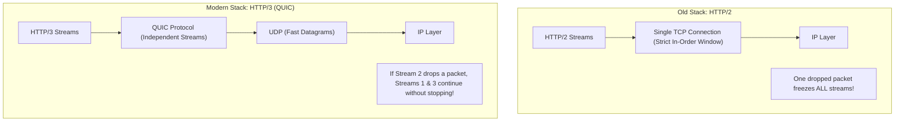
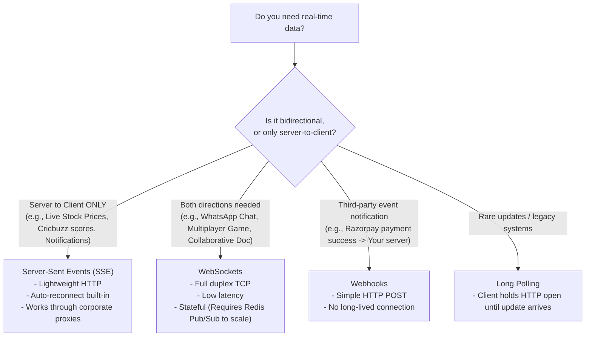
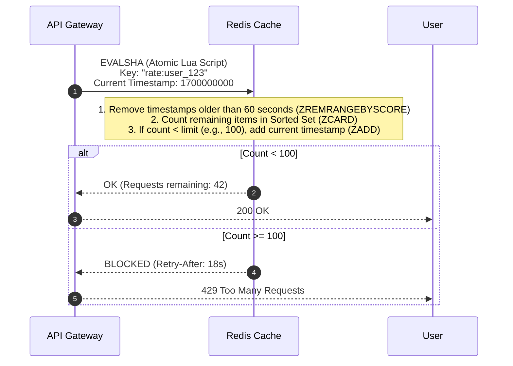
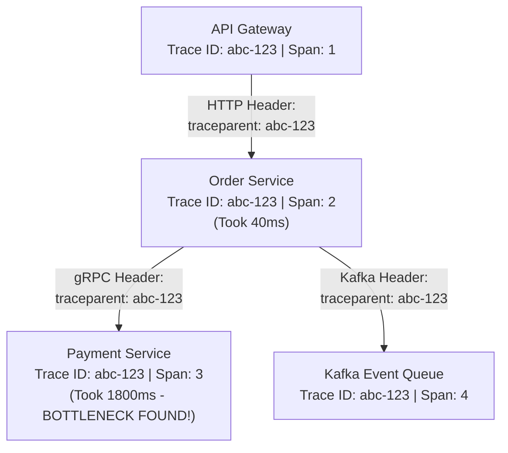
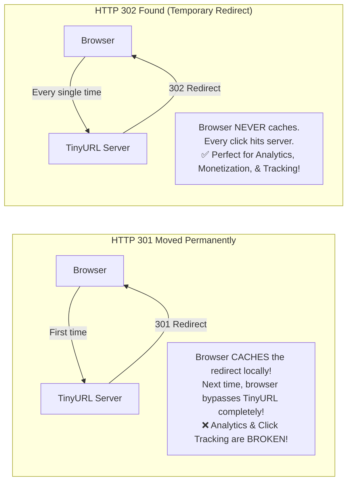
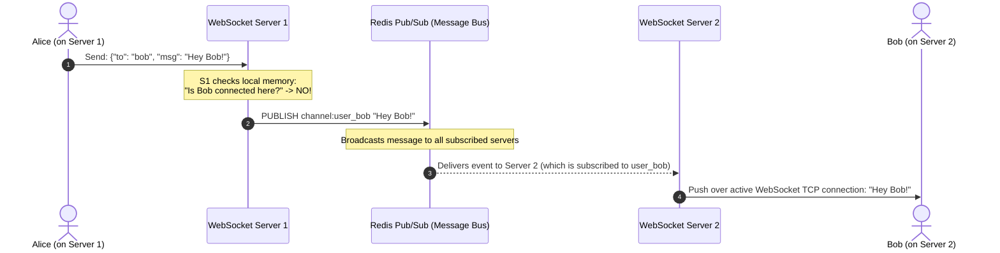
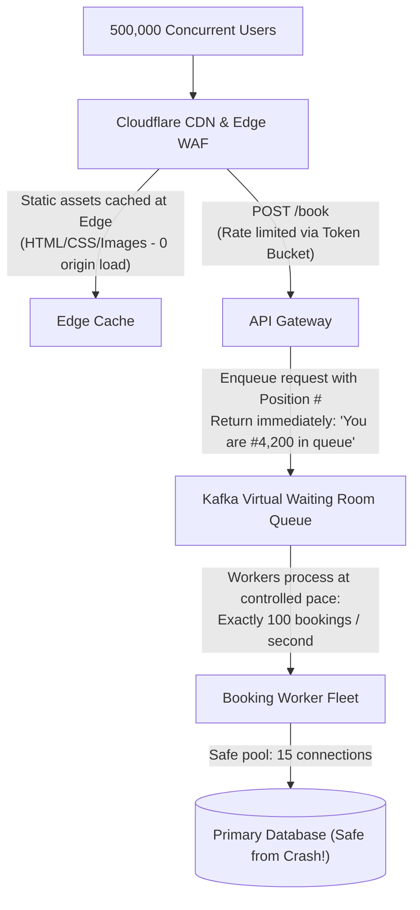

# Day 6 & 7 Combined Guide: Advanced System Design, Real-Time Protocols & Mock Interview Mastery

**For:** Backend developers with ~2 years experience preparing for ₹20+ LPA roles.  
**Style:** Plain English, zero academic jargon, visual diagrams, and practical system design scenarios.

---

## 🎯 What We Are Covering in this Final Guide

This guide covers the remaining **Day 6 & Day 7** topics to complete your 7-day networking mastery:

1. **HTTP/3 & QUIC (The Future of Web Networking)** — Why the internet is moving away from TCP to UDP.
2. **The Real-Time Decision Matrix** — Short Polling vs. Long Polling vs. WebSockets vs. Server-Sent Events (SSE) vs. Webhooks.
3. **Rate Limiting at the Network Edge** — Token Bucket, Leaky Bucket, and Sliding Window (with Redis Lua scripts).
4. **Distributed Tracing Across the Network** — How `Trace-Id` travels through 10 microservices.
5. **The 3 Classic System Design Networking Questions**:
   - TinyURL: Why `301 Moved Permanently` vs. `302 Found` makes or breaks analytics.
   - Live Chat / WhatsApp: Scaling 1,000,000 WebSockets horizontally using Redis Pub/Sub.
   - Flash Sale / Ticket Booking: Preventing network overload during high-concurrency spikes.
6. **"Latency Numbers Every Programmer Must Know"** — Practical rules of thumb.
7. **The ₹20+ LPA Mock Interview Final Drill** — 15 trick questions that separate junior from senior developers.

---

## 1. HTTP/3 & QUIC: Why UDP is Replacing TCP

In Day 1 and Day 2, we learned that TCP is reliable because it guarantees packet order.  
So why are Google, Cloudflare, and Meta now switching web traffic to **HTTP/3 over UDP**?

### The Problem with HTTP/2 over TCP: "Head-of-Line Blocking at the Transport Layer"

Imagine a highway with 3 lanes (representing 3 multiplexed HTTP/2 streams: CSS, JS, and Images):

```
HTTP/2 on TCP:
Stream 1 (CSS)   ───► [ Packet 1 ] ──► [ Packet 2 ] ───────► Arrived!
Stream 2 (JS)    ───► [ Packet 1 ] ──► 💥 (DROPPED!) ─────► STUCK!
Stream 3 (Image) ───► [ Packet 1 ] ──► [ Packet 2 ] ───────► WAITING FOR STREAM 2!
```

- In HTTP/2, all streams share **one single TCP connection**.
- If just **one single packet** from Stream 2 gets dropped on a train or bad Wi-Fi, the TCP operating system stack **freezes everything** until that missing packet is retransmitted.
- Stream 1 and Stream 3 have to sit idle, even though their packets arrived safely!

---

### The Solution: HTTP/3 (QUIC over UDP)

**QUIC** runs on top of **UDP**, but builds reliability inside the application layer:



### The 2 Superpowers of HTTP/3:

1. **Independent Streams:** If a packet drops on Stream 2, Stream 1 and Stream 3 keep rendering smoothly. No global stall!
2. **0-RTT Connection Resumption (Instant Reconnect):**
   - In TCP + TLS, when your phone switches from **Home Wi-Fi to 5G mobile data**, your IP address changes. The old TCP connection dies! You have to redo the entire 3-way handshake and TLS handshake (~150ms delay).
   - In QUIC, connections are identified by a **Connection ID** (a random 64-bit number), not by IP address. When you walk out of your house, your music or video stream keeps playing with **zero interruption**!

---

### 🎙️ Spoken Interview Answer (45 Seconds)
> "HTTP/2 solved application-level head-of-line blocking by multiplexing streams over one TCP connection, but it still suffered from transport-level head-of-line blocking: if a single TCP packet dropped, the entire connection stalled. HTTP/3 fixes this by running QUIC over UDP. Each stream is truly independent at the transport layer, so packet loss on one image doesn't block other assets. Furthermore, QUIC uses Connection IDs instead of IP addresses, allowing seamless connection migration when mobile users switch between Wi-Fi and cellular networks without renegotiating handshakes."

---

## 2. Real-Time Communication Decision Matrix

In System Design interviews, candidates often say: *"We will use WebSockets for everything real-time."*  
**Interviewers will penalize this.** WebSockets are stateful and expensive. You must choose the right tool for the job.



### Comparison Table for System Design Rounds

| Pattern | Connection Type | Direction | Complexity | Best Use Case |
|---|---|---|---|---|
| **Short Polling** | Standard HTTP | Client $\to$ Server | Lowest | Check status once every 5 minutes (e.g., order tracking). |
| **Long Polling** | HTTP held open | Client $\to$ Server | Low | Legacy chat or environments blocking WebSockets. |
| **WebSockets** | Persistent TCP | **Bidirectional** | High (Stateful) | Live chat, multiplayer gaming, collaborative Google Docs. |
| **Server-Sent Events (SSE)** | Persistent HTTP | **Server $\to$ Client Only** | Low (Stateless-friendly) | Stock tickers, AI streaming responses (ChatGPT tokens), live sports scores. |
| **Webhooks** | HTTP POST event | **Server $\to$ Server** | Low | Third-party integrations (Stripe, GitHub push events). |

> 💡 **Interview Pro-Tip on ChatGPT:**  
> When the interviewer asks: *"How does ChatGPT stream text word-by-word into the browser?"*  
> **Answer:** It does **NOT** use WebSockets! It uses **Server-Sent Events (SSE)** over standard HTTP, because text flows only in one direction (server to client) and SSE handles auto-reconnection natively.

---

## 3. Rate Limiting at the Network Boundary

Rate limiting protects your backend from brute-force attacks, scrapers, and cascading system overloads.

---

### Algorithm 1: Token Bucket (The Industry Standard - AWS / Stripe)

Imagine a bucket that holds up to **10 tokens**:
- Every second, a refill pipe drops **2 new tokens** into the bucket.
- The bucket can never hold more than 10 tokens (overflow spills away).
- When a user request arrives:
  - If a token is available $\to$ consume 1 token and allow the request.
  - If the bucket is empty $\to$ reject with **`HTTP 429 Too Many Requests`**.

```
Refill: 2 tokens / sec  ───► [ 🪙 🪙 🪙 🪙 ] (Capacity: 10)
                                      │
Incoming Request ─────────────────────┴──► Needs 1 token?
                                            ├── Available? ✅ Allow!
                                            └── Empty?     ❌ HTTP 429!
```

- **Why it is popular:** It handles **traffic bursts gracefully**. A user who was idle can send 10 requests instantly, but can never sustain more than 2 requests per second afterward.

---

### Algorithm 2: Sliding Window Counter (Distributed with Redis)

In a distributed microservice setup with 20 backend pods, how do you track rate limits globally?

**The Solution:** Use **Redis** with a Lua script (for atomic operations):



---

## 4. Distributed Tracing: Tracking Packets Across Microservices

In a modern architecture, one user click can trigger calls through **12 different microservices**.  
If the request takes 3 seconds, how do you know which service was slow?

```
User Click ──► API Gateway ──► Order Service ──► Payment Service ──► Fraud Service
```

### The Solution: W3C Trace Context (`traceparent` header)

Every incoming HTTP request gets stamped at the API Gateway with a **Trace ID**:

```
traceparent: 00-4bf92f3577b34da6a3ce929d0e0e4736-00f067aa0ba902b7-01
               └─── Global Unique Trace ID ───┘  └─── Span ID ───┘
```



- **Trace ID:** Remains identical across every single service hop.
- **Span ID:** Identifies each individual sub-step or network hop.
- Tools like **Jaeger**, **Zipkin**, or **Datadog** ingest these IDs and display a visual timeline showing exactly which network call or database query burned the 1800ms!

---

## 5. Classic System Design Networking Deep Dives

---

### Scenario A: URL Shortener (TinyURL) — `301` vs. `302` Redirects

When a user visits `https://tinyurl.com/xyz123`, the server redirects them to the long URL.  
**System Design Interview Question:** *"Will you return HTTP 301 or HTTP 302, and why?"*



| Status Code | Caching Behavior | Server Load | Click Analytics Tracking |
|---|---|---|---|
| **301 Moved Permanently** | Browser caches forever | **Lowest** (Browser skips server) | ❌ **Broken** (Server cannot count clicks) |
| **302 Found / 307 Temp** | Browser does not cache | Higher (Every click hits server) | ✅ **Accurate** (Tracks location, referrer, and user stats) |

> 🏆 **The Winning Interview Answer:**  
> *"If our primary business goal is tracking click metrics, referral sources, and user analytics, we must use **HTTP 302 Found**. If our goal is minimal server cost and maximum redirect speed where analytics do not matter, we use **HTTP 301 Moved Permanently**."*

---

### Scenario B: Scaling 1,000,000 WebSockets Horizontally (WhatsApp / Slack)

**The Problem:**  
- User A is connected to **Server 1**.  
- User B is connected to **Server 2**.  
- User A sends a message to User B. How does Server 1 deliver the packet to Server 2?



**Key Takeaways:**
1. WebSocket servers must be **stateless** regarding message routing by offloading discovery to **Redis Pub/Sub** or **Kafka**.
2. To detect dropped mobile connections (e.g., driving through a tunnel), client and server exchange **Heartbeat Ping/Pong frames every 30 seconds**. If 2 pings are missed, the server closes the dead socket to prevent memory leaks.

---

### Scenario C: Flash Sale / High-Concurrency Booking (BookMyShow / Tatkal)

When tickets go on sale at 10:00 AM, 500,000 users hit the buy button simultaneously.



1. **Static Offloading:** 95% of requests (images, seat maps, JS) are served from the **CDN Edge** without touching application servers.
2. **Virtual Waiting Room:** Requests are not processed synchronously against the database. They are pushed into a **Kafka queue**, and the frontend shows an active queue counter: *"You are in line: #4,200."*
3. **Controlled DB Ingestion:** Workers pull from the queue at a rate the database connection pool can comfortably handle, completely avoiding connection exhaustion and database crashes!

---

## 6. "Latency Numbers Every Programmer Must Know"

When designing systems, keep these practical rules of thumb in mind:

| Operation | Real-World Time | Takeaway for System Design |
|---|---|---|
| **L1 CPU Cache reference** | 0.5 ns | Extremely fast |
| **Main Memory (RAM) read** | 100 ns | In-memory caches (Redis) are blazing fast |
| **Read 1 MB sequentially from SSD** | 1,000,000 ns (1 ms) | Disk I/O is 10,000x slower than RAM |
| **Same Datacenter Network Round-Trip (RTT)** | **0.5 ms** | Internal microservice calls (gRPC) are fast |
| **Cross-Country RTT (Mumbai $\to$ Delhi)** | **~25 ms** | Geographic distance adds latency |
| **Cross-Continent RTT (Mumbai $\to$ USA)** | **~150 ms** | **Why CDNs are mandatory for international users** |

---

## 7. The Final ₹20+ LPA Mock Interview Drill: 15 Rapid-Fire Questions

#### Q1: Why does HTTP/3 use UDP instead of TCP?
> "HTTP/3 uses UDP via QUIC to eliminate transport-layer head-of-line blocking. In HTTP/2 over TCP, a single lost packet freezes all multiplexed streams until retransmitted. In HTTP/3, streams are completely independent, so packet loss on one stream does not impact others. It also provides 0-RTT connection resumption and connection migration for mobile devices."

#### Q2: When would you use Server-Sent Events (SSE) instead of WebSockets?
> "I use SSE when communication is strictly one-directional from server to client—such as live stock price tickers, news feeds, or streaming LLM text responses. SSE runs over standard HTTP, supports automatic reconnection out of the box, and bypasses corporate firewalls that often block raw WebSocket upgrades."

#### Q3: Why does TinyURL use HTTP 302 instead of HTTP 301?
> "HTTP 301 is permanently cached by browsers, meaning subsequent clicks bypass the URL shortener server completely. If we need to track click analytics, user geography, referrers, and device types, we must use HTTP 302 Found, ensuring every click hits our backend for metric logging before redirecting."

#### Q4: How does a Token Bucket rate limiter handle sudden traffic bursts?
> "A token bucket allows bursts up to its maximum capacity. If the bucket holds 10 tokens and refilled at 2 tokens/second, an idle user can immediately fire 10 requests back-to-back. Once the bucket is empty, the user is throttled strictly to the refill rate of 2 requests/second until they slow down."

#### Q5: How do you trace a slow request across 10 microservices?
> "We implement distributed tracing using standard headers like the W3C `traceparent`. The API Gateway creates a unique `Trace-ID` and passes it through HTTP and gRPC headers to downstream services. Observability tools like OpenTelemetry and Jaeger collect spans with this ID, rendering a visual waterfall timeline that highlights exactly which service or database call introduced the delay."

#### Q6: How do you scale a WebSocket server horizontally across multiple machines?
> "Because WebSockets maintain stateful TCP connections, different users end up connected to different servers. We place a lightweight message bus—like Redis Pub/Sub or Kafka—behind the WebSocket fleet. When Server 1 needs to send a message to a user connected to Server 2, it publishes the message to that user's Redis channel. Server 2 receives the event and pushes it down the user's active socket."

#### Q7: What is the difference between Bandwidth and Throughput?
> "Bandwidth is the theoretical maximum capacity of the communication channel (e.g., a 1 Gbps fiber line). Throughput is the actual volume of data successfully transmitted per second after accounting for packet loss, protocol header overhead, TCP congestion control, and network latency."

#### Q8: What happens if an API client loses internet connection while a POST request is running?
> "The client experiences a network timeout, but the server might have already completed the transaction. To prevent duplicate execution on retry, the client must send a unique `Idempotency-Key` UUID. The server caches the result in Redis so subsequent retries return the original successful response without double-processing."

#### Q9: What is the difference between a forward proxy and a reverse proxy?
> "A forward proxy sits in front of clients to regulate, cache, or anonymize their outbound internet requests. A reverse proxy sits in front of backend servers to protect them, terminating TLS, buffering slow client requests, enforcing rate limits, and load-balancing traffic across internal services."

#### Q10: What is DNS Anycast?
> "Anycast assigns the same IP address to multiple geographically distributed servers worldwide. Global BGP routing automatically sends user requests along the shortest physical network path to the nearest edge server, cutting round-trip latency and mitigating DDoS attacks."

#### Q11: What is a TCP reset (RST) packet?
> "A TCP RST packet is an immediate rejection sent by an operating system indicating that a packet arrived for a port where no application is currently listening, or that the connection was abruptly aborted. In client applications, this surfaces as a 'Connection Refused' error."

#### Q12: Why shouldn't you store sensitive user data in a JWT?
> "A standard JWT payload is only base64-encoded, not encrypted. Anyone who intercepts the token or inspects it in their browser dev tools can decode and read the JSON data. Only non-sensitive identification claims (like `userId` and `roles`) should be stored in the payload."

#### Q13: What does the HTTP status code 429 mean, and what header should accompany it?
> "HTTP 429 means 'Too Many Requests', indicating that the client exceeded their rate limit. The response should include a `Retry-After` header specifying how many seconds the client must wait before making another request."

#### Q14: What is the purpose of connection keep-alive in HTTP/1.1?
> "Keep-alive allows a single TCP connection to be reused for multiple sequential HTTP requests and responses, avoiding the latency and CPU overhead of repeating the 3-way TCP handshake and TLS negotiation for every individual resource."

#### Q15: How do you prevent a cache stampede during a flash sale?
> "We use distributed locks or probabilistic early expiration. When a cached key is near expiration, the system allows only one background worker thread to acquire a mutex lock, re-query the database, and refresh the cache, while continuing to serve the slightly stale cached value to all other incoming requests."

---

## 🏆 You Have Completed the Full 7-Day Networking Curriculum!

You now possess a complete, end-to-end understanding of computer networking—from low-level TCP/UDP packets all the way to high-scale distributed system architectures.

### 📚 Complete Study Suite Reference:

- 📄 [`DAY1_INTERVIEW_GUIDE.md`](./DAY1_INTERVIEW_GUIDE.md) — OSI, TCP/UDP, DNS, IP/Ports, HTTP/HTTPS, Latency
- 📄 [`DAY2_INTERVIEW_GUIDE.md`](./DAY2_INTERVIEW_GUIDE.md) — HTTP/2, WebSockets, REST, CORS, JWT vs Sessions, Caching
- 📄 [`DAY3_INTERVIEW_GUIDE.md`](./DAY3_INTERVIEW_GUIDE.md) — Reverse Proxies, L4 vs L7, API Gateways, gRPC, DB Pooling, Kafka vs RabbitMQ
- 📄 [`DAY4_5_INTERVIEW_GUIDE.md`](./DAY4_5_INTERVIEW_GUIDE.md) — Plain English HTTPS, NAT, CDNs, epoll Sockets, Production Debugging, "Pay Now" flow
- 📄 [`DAY6_7_INTERVIEW_GUIDE.md`](./DAY6_7_INTERVIEW_GUIDE.md) — [THIS FILE] HTTP/3 QUIC, Real-Time Decision Matrix, Rate Limiting, TinyURL/WhatsApp/Flash-Sale System Design & Final Mock Drill! 🚀
